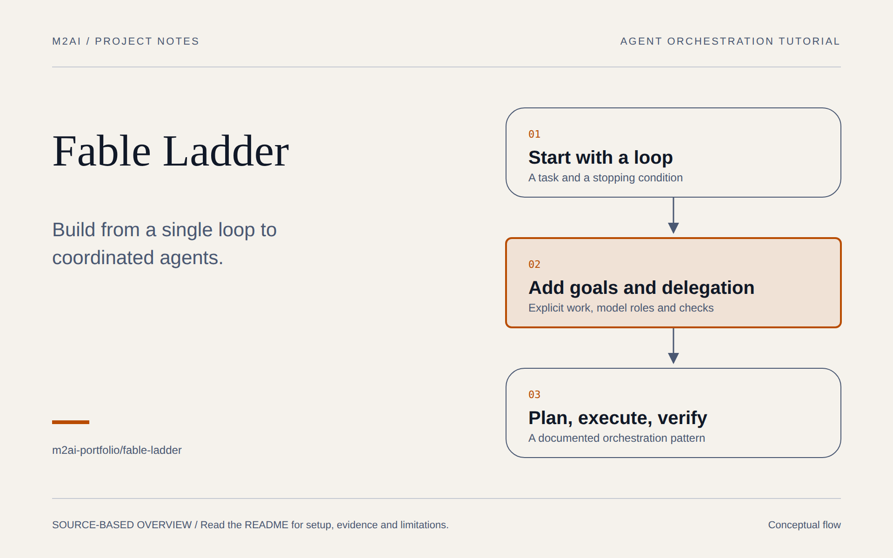

# The Fable Ladder



You can ask an AI assistant to do one task. The harder question is how to turn that task into a repeatable process without losing control of what runs, what it costs, or when it stops. The Fable Ladder teaches that progression one rung at a time, with a concrete asset to copy at each stage.

**[Open the interactive guide](https://m2ai-portfolio.github.io/fable-ladder/)**

## What you will learn

| Rung | Practical lesson |
|---|---|
| Your first loop | Give a repeatable task a trigger. |
| Loop prompting | Write a bounded, specific prompt that can run again safely. |
| Goals | Define an observable finish line rather than counting runs. |
| Sub-agents | Give a worker its own context and a narrow responsibility. |
| Fable orchestration | Separate planning and judgment from parallel execution. |

The guide combines explanations, copyable examples, and version checks. It is an educational artifact, not an installed agent runtime.

## Open it locally

You only need Git and a modern browser. There is no package installation, build step, API key, or backend to configure.

```bash
git clone https://github.com/m2ai-portfolio/fable-ladder.git
cd fable-ladder
```

Open [index.html](index.html) in your browser. All page styling, example text, and interaction code live in that file.

## First walkthrough

1. Read **Your first loop** and identify one small, repeatable task you already understand.
2. Use **Loop prompting** to add scope, repeat-run behavior, and a stop condition.
3. Add a goal with an observable result before introducing more workers.
4. Copy a sub-agent example and replace its sample task with your own bounded assignment.
5. Read **Before you climb: verify your version** before trying any orchestration command.

The copy buttons use the browser clipboard API when available, with a fallback for other contexts. If your browser blocks copying, select the example text manually.

## Adapting the examples

Edit `index.html` to change the teaching copy, styles, or example source strings. After editing, open the page, follow each rung link, and check that every copy button returns the full corresponding example.

The commands and model labels describe the authoring environment captured in this guide. Check your installed Claude Code version and current tool access before running them. Copying a prompt does not install the required tool, authorize a task, or guarantee the example's outcome.

## Project status and attribution

A static learning resource by Matthew Snow / [M2AI](https://memyselfplusai.com). The repository contains the guide itself; it does not bundle the models or orchestration services described. No license file is included in this snapshot, so do not infer a reuse license from public visibility.
